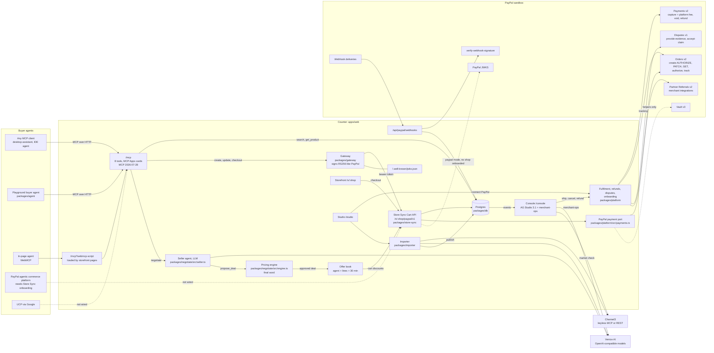

# Architecture

Counter is one Next.js app (`apps/web`) on top of eight workspace packages. Buyer agents reach a shop through MCP; every cart and checkout goes through that shop's own Store Sync Cart API; every payment is a PayPal Orders v2 order that is authorized at checkout and captured when the shop ships.

Legend: solid arrows are wired and running today; dotted arrows are not wired. The PayPal arrows are wired in code and covered by fixture tests; whether they have run live against the PayPal sandbox is in [Live PayPal verification](#live-paypal-verification).

## Components

**MCP server** (`apps/web/app/mcp/route.ts`, tools in `packages/gateway/src/tools.ts`). Eight tools: `list_shops`, `search_products`, `get_product`, `negotiate`, `create_cart`, `update_cart`, `checkout`, `order_status`. Served with `mcp-handler` 2.3 on `@modelcontextprotocol/server` 2.4: revision 2026-07-28 with a per-request envelope, and 2025-11-25 for clients that open with `initialize`. `get_product`, the cart tools and the checkout tools link MCP Apps cards (`ui://counter/product.html`, `cart.html`, `approval.html`, in `packages/gateway/src/apps`); hosts without MCP Apps support use the text and structured output. The same tools are offered to in-page agents on storefront pages through the WebMCP bridge script (`/mcp?webmcp-script`, loaded in `apps/web/app/s/[shop]/(storefront)/layout.tsx`).

**Gateway** (`packages/gateway`). Plays PayPal's agentic platform in sandbox. For each cart call it signs a bearer token with the claims PayPal's platform uses (`packages/gateway/src/jwt.ts`): RS256, `iss: paypal.com`, scopes `cart` or `cart` + `checkout`, `external_id` naming `PayPal:<merchant id>` and `Client_Identifier:<agent>`, ten-minute expiry. The public key is served at `/.well-known/jwks.json`.

**Store Sync Cart API** (`packages/store-sync`, route `apps/web/app/s/[shop]/paypal/v1/[[...path]]/route.ts`). The merchant side of PayPal's Store Sync: `POST /merchant-cart`, `GET` and `PUT /merchant-cart/{id}`, `POST /merchant-cart/{id}/checkout`. It verifies the token before routing (against the gateway key in `sandbox` mode, or PayPal's JWKS in `paypal` mode), parses the body with `PayPalCartSchema` from `@paypal/commerce-cart-zod@1.4.0`, prices items, shipping (US only), tax and offers, and drives the payment port. Conformance details, including three assertions in PayPal's Postman collection that contradict its own schema: [`store-sync-conformance.md`](store-sync-conformance.md).

**Negotiation** (`packages/negotiate`, `packages/platform/src/negotiation.ts`). The seller agent sees list prices, stock, the shop's discount rules and its voice, never floors or costs, and proposes a deal with one tool, `propose_deal`. The pricing engine (`engine.ts`, pure, integer cents) accepts it, clamps it to the closest deal the rules allow, or refuses it: never below floor, never above list, total discount within the shop's cap, at most 5% off each unit unless the cart is a bundle, nothing when the shop has negotiation off or a line is out of stock. A proposal below the floor is answered above it (floor plus 40% of the gap to list, rounded up to 50 cents), so a lowball never reveals the floor. Every dollar amount in the seller's reply must be one of the engine's numbers. An approved deal becomes an offer bound to the agent client, the shop, the exact lines and quantities and a 30-minute expiry, stored in Postgres; Store Sync applies it as a cart `discounts` entry, which reaches PayPal as `breakdown.discount`.

**PayPal** (`packages/paypal` on `@paypal/paypal-server-sdk` 2.5 plus REST; `packages/platform`). Orders and payments go through the SDK's `OrdersController` and `PaymentsController`; partner referrals, merchant integrations, disputes, webhook verification and Vault v3 go through REST with the same token cache. For a shop onboarded with its own PayPal account, every call carries `PayPal-Auth-Assertion` and `PayPal-Partner-Attribution-Id`, and orders name the shop as `payee`. The flow:

| Store Sync / merchant event | PayPal call | Code |
| --- | --- | --- |
| Cart created | Orders v2 create, `intent: AUTHORIZE` | `packages/platform/src/payments.ts`, `packages/paypal/src/orders.ts` |
| Cart changed | Orders v2 `PATCH` (amount, items, shipping); a new order if PayPal reports the old one expired | same |
| Checkout | The MCP `checkout` tool reads the buyer's approval with Orders v2 `GET`; Store Sync checkout then calls `authorize`, books the order and reserves stock | `packages/gateway/src/tools.ts`, `packages/platform/src/order-lookup.ts`, `packages/store-sync/src/handlers.ts`, `packages/platform/src/fulfilment.ts` |
| Shipped | Payments v2 capture (`final_capture`, `platform_fees` 2% for onboarded shops), then Orders v2 `track` | `packages/platform/src/fulfilment.ts` |
| Cancelled before shipping | Payments v2 void; stock restored | same |
| Refund | Payments v2 refund, full or partial | same |
| Webhook delivery | `verify-webhook-signature` over the exact bytes; each event id handled once | `packages/platform/src/webhooks.ts` |
| Dispute | Decided by rule from the order's record; evidence PDF via `provide-evidence`, or `accept-claim` | `packages/platform/src/disputes.ts`, `pdf.ts` |
| Shop connects PayPal | Partner Referrals v2, then merchant integrations for status | `packages/platform/src/onboarding.ts` |

Order states: `authorized`, `captured`, `voided`, `refunded`, `disputed` (`packages/db/src/schema.ts`).

**Importer** (`packages/importer`, Studio at `/studio`). Turns a product page URL, a photo (vision model) or a CSV into product drafts with agent-legible variants. Channel3 resolves product pages and finds comparable listings for a market check (low, median, high, and where the shop sits); it uses Channel3's keyless MCP server unless `CHANNEL3_API_KEY` selects the REST API. The suggested floor is a deterministic rule a merchant can check by hand (`floor.ts`): the highest of cost x 1.25, price less the shop's maximum discount, and market low x 0.9, never above list. The merchant reviews every draft before publishing.

**Console** (`apps/web/app/console`, `apps/web/components/console`). An AG Studio 3.1 dashboard over the shop's own data, with three custom widgets (`agent-stream`, `floor-ladder`, `market-position`) and a `merchant-ops` agent in Studio's AI harness. Its tools: `list_orders_to_ship`, `ship_order` (prepares a shipment; the capture runs when the merchant presses Confirm), `explain_negotiation`, `set_floor` (refused server-side below cost x 1.25 or above list), `market_check`. Merchant actions run the platform's own fulfilment code on the server (`apps/web/app/api/console/[shop]/actions/route.ts`), accept same-origin requests only and are rate limited. The Console's data API serves floors, costs, orders and transcripts only to a signed merchant session cookie, which the demo grants with one click ("View as Rosa (demo merchant)"); there is no real merchant sign-in.

**Storefront and Playground.** `/s/<shop>` is the shop for people: server-rendered pages whose "Checkout with PayPal" creates a Store Sync cart with the client identifier `Storefront`. `/playground` streams a buyer agent (`packages/agent`) shopping through Counter's own MCP server, one tool call at a time.

**Data** (`packages/db`). Drizzle on Postgres (Neon HTTP driver in production, in-process PGlite in tests). Tables: `shops`, `variants`, `carts`, `orders`, `events`, `negotiations`, `offers`, `disputes`. Every Store Sync call is logged as an event, and the agent's own cart request is kept beside the cart as dispute evidence.

## Live PayPal verification

| What | Status |
| --- | --- |
| PayPal sandbox round trip on the deployment: create AUTHORIZE order, buyer approval, authorize, capture on ship, void and refund, webhooks, dispute evidence, partner onboarding | **Verified live on the sandbox** for the core path: AUTHORIZE order created by the Store Sync API, buyer approval in PayPal, authorize, capture on ship with tracking (JC-10001, LL-10001), void on cancel (NP-10001), webhooks received and verified. Order and capture ids: [docs/live-verification.md](live-verification.md). Refund, a buyer-raised dispute and a second seller's onboarding are covered by fixture tests and not yet run live. |

## Not wired

- **PayPal's agentic commerce platform calling a Counter shop.** Real agent traffic from PayPal needs Store Sync onboarding (US merchants, physical goods, USD, by application). The verification path for PayPal-signed tokens exists (`jwksMode: paypal`), but no shop is onboarded.
- **UCP with PayPal.** Needs enablement by Google.
- **Vault v3.** Setup tokens, payment tokens and charging a vaulted wallet are implemented and tested in `packages/paypal/src/vault.ts`; no flow calls them.
